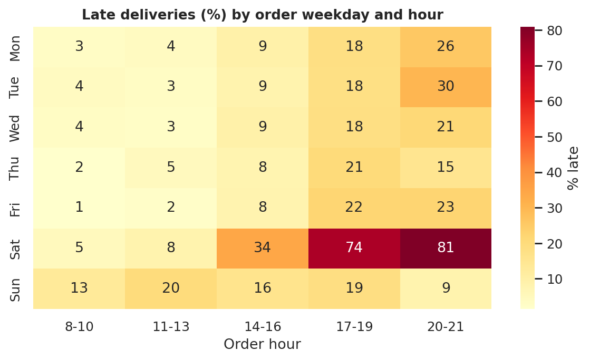
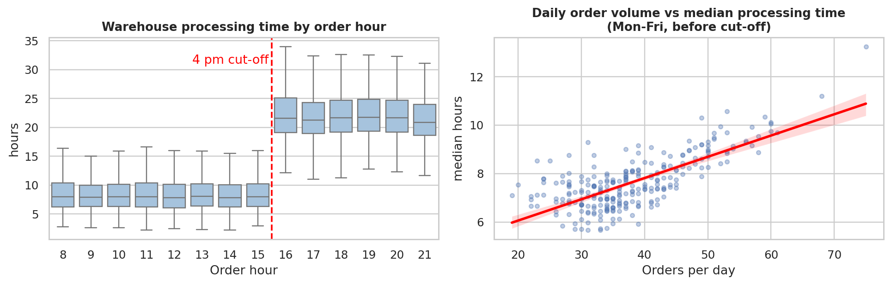
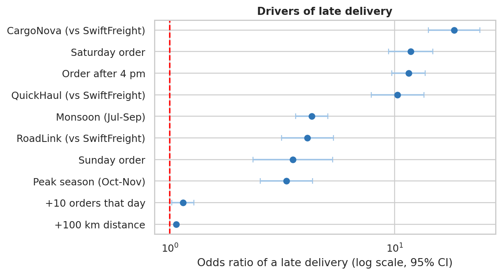
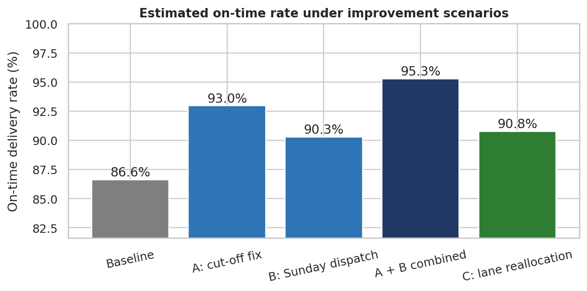

# Advanced Data Analysis and Visualization in Logistics

Code accompanying the report *Week 3 Task: Advanced Data Analysis and Visualization in Logistics*.

The project analyses a **simulated** year of shipments for a regional distributor (one hub, six destination cities, four carriers). It covers exploratory data analysis, 13 visualisations, regression models for cost and lateness, and improvement scenarios. Known patterns were built into the simulated data on purpose so the methods can be checked; the findings demonstrate the method and are not claims about a real company.

## Dataset (simulated, 12,000 shipments, 2024)
Order, dispatch, delivery and promised dates; carrier; destination; product category; vehicle type; distance; units; weight; order value; freight cost; customer rating; delay reason. Generated by `src/00_simulate_dataset.py` with a fixed seed. Assumed already cleaned with the Week 2 pipeline.

## Analysis steps
| Script | What it does |
|---|---|
| `src/00_simulate_dataset.py` | Creates `data/shipments.csv` |
| `src/common.py` | Loads data, adds derived columns (processing hours, lead time, delay, on-time flag, cost per kg), sets plot style |
| `src/01_eda_summary.py` | KPIs, descriptive statistics, correlations, carrier and city summaries |
| `src/02_visualizations.py` | Figures 1-11: distributions, box plots, correlation heatmap, monthly trend, lateness heatmap, warehouse bottleneck, cost drivers, carrier trade-off, lane heatmap, Pareto chart, rating vs delay |
| `src/03_drivers_whatif.py` | OLS cost model, logistic lateness model (odds ratios, AUC), what-if scenarios (Figures 12-13) |

## Setup and run
```bash
python -m venv .venv
source .venv/bin/activate        # Windows: .venv\Scripts\activate
pip install -r requirements.txt
python run_pipeline.py
```
Use `python run_pipeline.py --skip-simulation` to reuse an existing `data/shipments.csv` (or your own file with the same columns).

## Key results (from `reports/summary.json`)
- **Shipments:** 12,000; **on-time rate:** 86.6%; **average lead time:** 3.27 days; **average rating:** 4.50/5.
- **Orders after the 4 pm cut-off** are 41.4% of orders but 79.0% of late shipments; median processing time is 7.9 h before the cut-off and 21.5 h after it.
- **Saturday evening orders** are 74-81% late (no Sunday dispatch).
- **Worst lanes:** CargoNova and QuickHaul to Chennai and Kolkata (31-39% late); SwiftFreight is never above 6% on any lane.
- **Cost model:** R-squared 0.919; distance and weight dominate; peak season adds about INR 14.7 per shipment.
- **Lateness model:** AUC 0.877 on the last 20% of shipments (time-ordered split).
- **Scenarios (estimated on-time rate):** baseline 86.6%, cut-off fix 93.0%, Sunday dispatch 90.3%, both 95.3% (approximate), lane reallocation 90.8% at about INR 59 per late shipment avoided.

## Figures
All 13 figures are in `figures/` (for example `fig05_lateness_heatmap.png`, `fig06_warehouse_bottleneck.png`, `fig12_odds_ratios.png`).






## Limitations
Simulated data with designed relationships; associations are not proof of cause; scenario results are estimates under stated assumptions.

## Author
Ansh Tandekar, Logistics Data Analyst Intern
